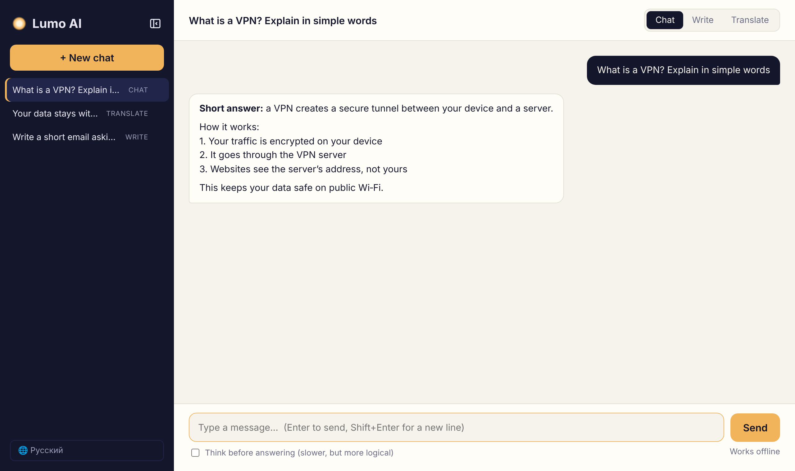

# Lumelle AI

**A private AI assistant that runs entirely on your own laptop. No internet, no cloud, no data leaks.**

Lumelle runs on Windows, macOS and Linux. It combines a local open-source language model with a small web app. It has six modes: **Chat**, **Write**, **Translate**, **Slides**, **Learn** and **Science**. Conversations are saved locally, and the model remembers the context of each chat.



## Features

- **Any language**: every mode answers in the language you write in, or in the one you ask for
- **Chat**: ask questions and get structured answers (a short answer first, then the details)
- **Write**: emails, posts and essays in the requested tone and length
- **Translate**: any language pair — name the target ("to Spanish: …"); by default Russian → English and everything else → Russian
- **Slides**: give a topic and get a slide plan, speaker notes and a ready PowerPoint file (.pptx) to download
- **Learn**: a language tutor (English by default, or any language you name): finds your level, explains grammar, gives exercises and checks them, teaches words, practises conversation and corrects your mistakes
- **Documents**: a knowledge base with folders; upload .docx / .pdf / .xlsx / .txt / .md and turn on “From my documents”; Lumelle finds the relevant parts with offline keyword search (BM25) plus search by meaning when an embedding model is installed (`ollama pull qwen3-embedding:0.6b`); “Only from them” forbids answers from general knowledge and shows which file and part the answer comes from
- **Online models (optional)**: GigaChat (free for individuals; the Russian root CA in `certs/` is trusted only for GigaChat), Claude, ChatGPT or Perplexity with the owner’s own API key (model lists come from the services); falls back to the local model without internet; guests, images and slides always stay local
- **Science mode and “/” commands**: a research assistant that never invents sources; `/plan`, `/review`, `/test`, `/edit` (also in Russian: `/план`, `/обзор`, `/тест`, `/редактура`) and your own saved commands
- **Model picker**: admin chooses which downloaded Ollama model answers (default `qwen3:8b`) and can switch back at any time
- **Train your own model**: [`training/`](training/README.md) distils qwen3:8b into a small Qwen3‑1.7B with MLX LoRA on a Mac and adds it to Ollama as `lumelle-mini`
- **Voice**: 🎤 records your question and a local Whisper model (faster-whisper) turns it into text; 🔊 and “Read answers aloud” speak the answers with the system voices. With read-aloud on, Lumelle works as a voice conversation
- **Accounts**: `admin` (owner) and `guest` out of the box; admin adds, resets and deletes users with the 👥 button. Everyone has their own chats, a new user replaces the temporary password at first sign-in, passwords are stored as PBKDF2 hashes, and 5 wrong attempts lock the login for 5 minutes
- **Chat history**: chats are stored in a local SQLite database and survive restarts
- **Context memory**: the model sees the last 20 messages of the current chat
- **Images**: attach a screenshot (📎, paste with Ctrl+V / Cmd+V or drag and drop), for example a test question, and Lumelle reads it with a local vision model
- **"Think before answering"**: optional reasoning mode for harder questions (slower, more logical)
- **Fully offline**: no external requests, no CDNs, system fonts only
- Interface in Russian, English, Chinese, French and German (auto-detected, switchable)
- Light and dark theme, mobile layout

## How it works

```
Browser (static/index.html)
        │  HTTP, localhost
        ▼
FastAPI backend (main.py) ──── SQLite (lumelle.db): chats and messages
        │  HTTP, localhost:11434
        ▼
Ollama ──── qwen3:8b (local LLM)
```

The backend adds a system prompt and a temperature for the chat's mode (chat 0.4, write 0.7, translate 0.1, slides 0.5, learn 0.4, science 0.3), loads the chat history from SQLite and sends everything to the model through the Ollama API.

## Tech stack

| Layer | Technology |
|---|---|
| Model | Qwen3 8B (text) and Qwen3-VL 8B (images) via [Ollama](https://ollama.com) |
| Backend | Python, FastAPI, httpx, Uvicorn, python-pptx, faster-whisper |
| Storage | SQLite (Python standard library) |
| Frontend | HTML, CSS, vanilla JavaScript (no frameworks, no build step) |

## Getting started

Lumelle runs on **Windows, macOS and Linux**. You need [Python 3.9+](https://www.python.org/downloads/) and [Ollama](https://ollama.com/download). The internet is needed only for the first setup.

1. Install Ollama and download the models:
   ```bash
   ollama pull qwen3:8b      # text
   ollama pull qwen3-vl:8b   # images (optional, ≈6 GB)
   ```
2. Download the project (`git clone https://github.com/surnova2703/lumelle.git` or **Code → Download ZIP**).
3. Start it:

   | System | How to start |
   |---|---|
   | Windows | double-click `start.bat` |
   | macOS | double-click `start.command` (or run `./start.sh` in Terminal) |
   | Linux | run `./start.sh` |

   The first start creates a Python environment and installs the libraries. Then the browser opens http://127.0.0.1:8000.

Step-by-step instructions for each system: **[Installation guide (English)](INSTALL_EN.md)** · **[Инструкция по установке (русский)](INSTALL_RU.md)**. The same guide opens inside Lumelle with the **Installation** button on the start screen.

**First sign-in:** `admin` / `admin` (owner) or `guest` / `guest`. Change both passwords with the 👥 button before other people use Lumelle.

Options: `--model` picks the text model, `--keep-alive 0` frees memory right after each answer (by default the model stays loaded for 30 minutes and is preloaded at start, so answers come faster), `--lan` lets other devices in your network (or Tailscale) open Lumelle, `--port 9000` changes the port, `--no-browser` doesn't open the browser.

### Hardware

| Computer | What works well |
|---|---|
| Apple Silicon Mac, 16 GB | `qwen3:8b` (tested on a MacBook Air) |
| Windows / Linux with an NVIDIA GPU (8 GB+) | `qwen3:8b`, fast |
| Laptop without a GPU, 8–16 GB RAM | `qwen3:4b` — slower, but works |

A smaller model is chosen at start: `start.bat --model qwen3:4b` on Windows, `./start.sh --model qwen3:4b` on macOS/Linux (download it first with `ollama pull qwen3:4b`). The image model: `--vision-model qwen3-vl:4b`.

Phones and tablets (iPhone, Android) open Lumelle in the browser when the computer runs it with `--lan`.

## API

| Method | Endpoint | Description |
|---|---|---|
| `POST` | `/login` | Sign in: `{"name": "admin", "password": "...", "remember": true}` |
| `POST` | `/logout` | Sign out |
| `GET` | `/me` | Who is signed in |
| `GET` | `/users` | List users (admin only) |
| `POST` | `/users` | Add a user with a temporary password (admin only) |
| `POST` | `/users/password` | Reset a user's password (admin only) |
| `DELETE` | `/users/{name}` | Delete a user and their chats (admin only) |
| `POST` | `/me/password` | Change your own password |
| `GET` | `/documents` | My documents |
| `POST` | `/documents` | Upload a document (multipart `file`) |
| `PATCH` | `/documents/{id}` | Move a document to another folder (`collection`) |
| `GET` | `/documents/status` | Is search by meaning available |
| `DELETE` | `/documents/{id}` | Delete a document |
| `GET` | `/cloud` | Online models: which keys are set (admin) |
| `POST` | `/cloud` | Save or remove a key, choose a model (admin) |
| `GET` | `/commands` | Built-in and my own “/” commands |
| `POST` | `/commands` | Save my own command (`name`, `prompt`) |
| `DELETE` | `/commands/{name}` | Delete my own command |
| `GET` | `/models` | Downloaded models and the current one |
| `POST` | `/models/current` | Choose the answering model (admin only) |
| `POST` | `/transcribe` | Speech to text (multipart `audio`), local Whisper |
| `POST` | `/ask` | One-off question, not saved: `{"mode": "chat", "text": "...", "think": false}` |
| `POST` | `/chats` | Create a chat: `{"mode": "translate"}` |
| `GET` | `/chats` | List chats |
| `GET` | `/chats/{id}` | Get a chat with all its messages |
| `POST` | `/chats/{id}/ask` | Send a message in a chat (with context): `{"text": "...", "think": false}` |
| `PATCH` | `/chats/{id}` | Change the chat's mode |
| `DELETE` | `/chats/{id}` | Delete a chat |
| `GET` | `/decks/{file}` | Download a presentation made in Slides mode |

## Project structure

```
lumelle/
├── main.py            # FastAPI backend: modes, chat history, Ollama client
├── docs_search.py     # documents: reading .docx/.pdf, fragments, offline search
├── slides.py          # Slides mode: builds .pptx files from the model's outline
├── run.py             # cross-platform launcher (checks Ollama, opens the browser)
├── start.bat / start.sh / start.command  # double-click starters
├── static/index.html  # web interface
├── INSTALL_EN.md / INSTALL_RU.md  # installation guides (also shown in the app)
├── training/          # distil your own small model (MLX LoRA → GGUF → Ollama)
├── requirements.txt
└── docs/              # screenshots and presentations
```

## Roadmap

- [ ] Streaming answers (word by word)
- [ ] Desktop app for Windows, macOS and Linux (Tauri)
- [ ] Model selection in the interface
- [ ] Password protection for access from other devices

## Presentations

The start screen has an **About the product** button: choose a language, then an introduction or a technical presentation, and the slides open right inside the app.

| Presentation | PowerPoint | PDF |
|---|---|---|
| Introduction · English | [pptx](docs/Lumelle_presentation_EN.pptx) | [pdf](docs/Lumelle_presentation_EN.pdf) |
| Technical · English | [pptx](docs/Lumelle_tech_EN.pptx) | [pdf](docs/Lumelle_tech_EN.pdf) |
| Introduction · Русский | [pptx](docs/Lumelle_presentation_RU.pptx) | [pdf](docs/Lumelle_presentation_RU.pdf) |
| Technical · Русский | [pptx](docs/Lumelle_tech_RU.pptx) | [pdf](docs/Lumelle_tech_RU.pdf) |
| Introduction · 中文 | [pptx](docs/Lumelle_presentation_ZH.pptx) | [pdf](docs/Lumelle_presentation_ZH.pdf) |
| Technical · 中文 | [pptx](docs/Lumelle_tech_ZH.pptx) | [pdf](docs/Lumelle_tech_ZH.pdf) |
| Introduction · Français | [pptx](docs/Lumelle_presentation_FR.pptx) | [pdf](docs/Lumelle_presentation_FR.pdf) |
| Technical · Français | [pptx](docs/Lumelle_tech_FR.pptx) | [pdf](docs/Lumelle_tech_FR.pdf) |
| Introduction · Deutsch | [pptx](docs/Lumelle_presentation_DE.pptx) | [pdf](docs/Lumelle_presentation_DE.pdf) |
| Technical · Deutsch | [pptx](docs/Lumelle_tech_DE.pptx) | [pdf](docs/Lumelle_tech_DE.pdf) |

---

Author: Varvara Surnova · [@surnova2703](https://github.com/surnova2703)
